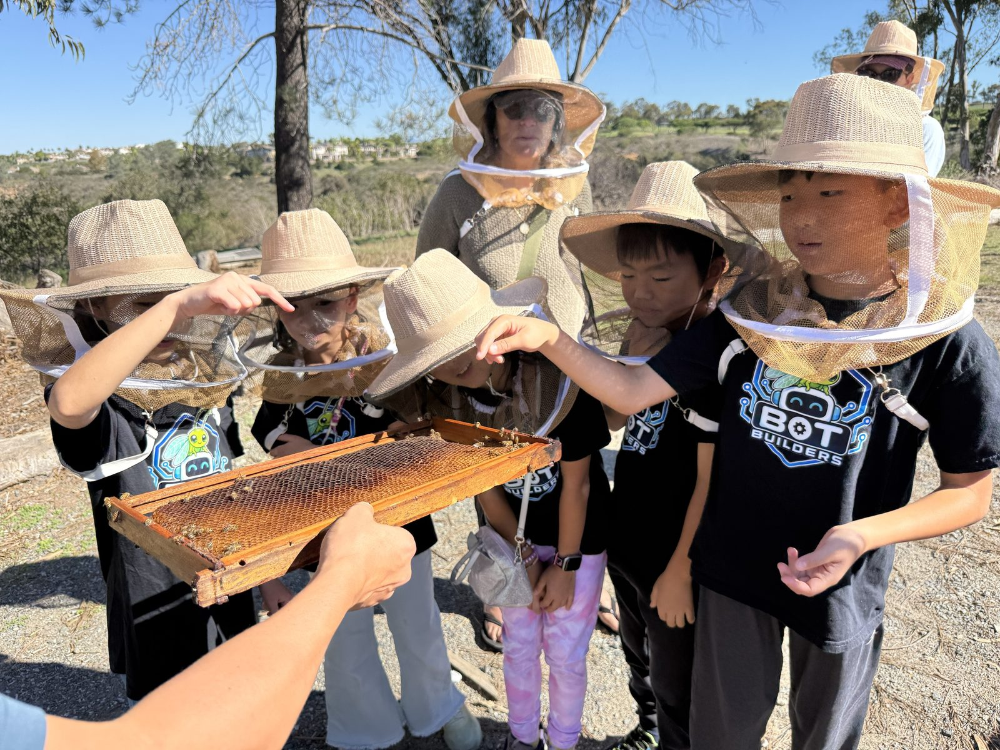
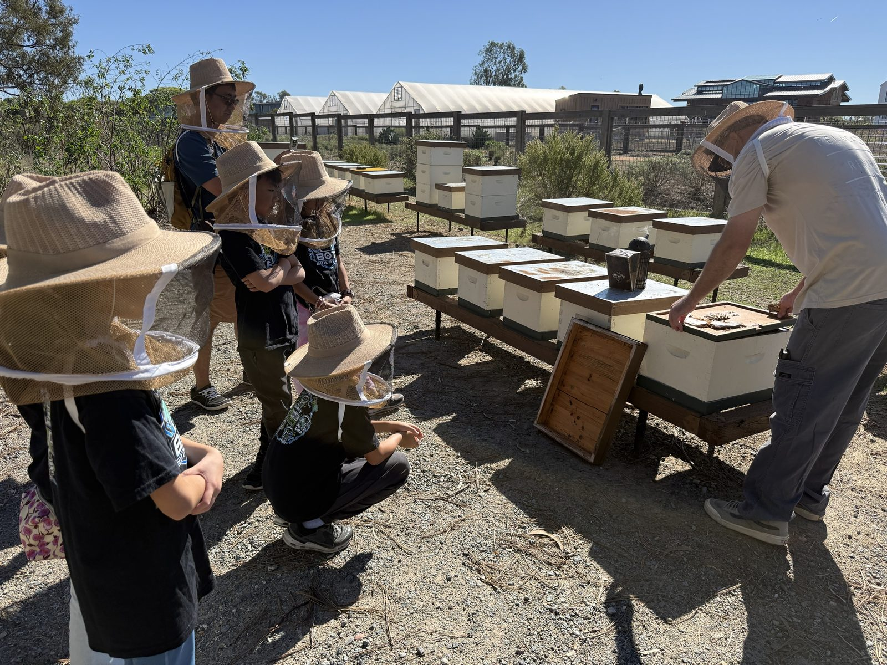

# Fox Point Farms Bee Tour — Sunday 25 October 2026

**Summary**: The team's third farm visit, and the first one that was also a public outreach event. A beekeeper walked the group through a honeybee rescue sanctuary's hive at Fox Point Farms, Encinitas — what each bee does at each age, how a queen is made, how honey is harvested and why bees need protecting from ants. Written up from a live transcript.

**Sources**: raw/source-docs/fox-point-bee-tour-2026-10-25.md (15 parts, pasted live by Kevin during the tour); three photos taken on the tour, 25 Oct 2026 (`docs/assets/bee-tour/`); team announcement, 24 Oct 2026

**Last updated**: 2026-10-25

---

> **Read this first.** The transcript is speech-to-text, pasted in pieces, and every piece starts and ends mid-sentence — so there are gaps, and some words are mangled. Everything below is **what the guide said**, attributed to him. Where a figure or a claim looks off or is the kind a judge would question, it is listed under [Check before the board uses it](#check-before-the-board-uses-it), not quietly corrected.

## At a glance

| | |
|---|---|
| **When** | Sunday 25 October 2026, 10:30 AM bee tour; arrive 10:15 |
| **Where** | Fox Point Farms, 1200 Fox Point Farms Lane, Encinitas |
| **Who went** | Five kids and two adults (5 kids' + 2 adult tickets). See [[team-roster]] |
| **Guide** | A beekeeper who runs a **honeybee rescue sanctuary**. He appears to be a beekeeper who **works with the farm** rather than farm staff ("this farm is giving") |
| **After the tour** | The station was set up with the board and bugs: **30-plus visitors** stopped at the station, heard about the lacewing from the kids, and took the survey; the kids explained the project well (see [[outreach-event]]). Then lunch and the Week 13 meeting (see [[calendar]]) |

## Photos from the tour

*The team looking at a frame of comb. A few bees are still on it. The guide let the kids look closely and touch the wax (source: part 7; photo, 25 Oct 2026).*

*The apiary: a row of white hive boxes on wooden stands. The guide lifts a lid while the team watches from a few metres back. What looks like the **smoker** — a dark can with a spout — sits on top of the next hive. **He wears a veiled hat and no full suit**, matching what he said about small hives (source: parts 9, 11; photo, 25 Oct 2026).*

*A frame lifted from a hive, covered in worker bees — yellow comb shows at the edges. Every bee in this picture is a female worker (source: part 3; photo, 25 Oct 2026).*

## What the guide does

(source: fox-point-bee-tour-2026-10-25.md, part 1)

- Runs a **honeybee sanctuary**: bees rescued from walls and boxes are taken to a main yard "out in Palma Valley off the 76 freeway" *(probably Pala Valley — speech-to-text)*, **revived to full health**, and some are **reintroduced into urban settings**.
- Partners with **hotels, restaurants, business complexes and campuses** that want bees on their property — and looks after the hives for them.
- About **half of their rescue calls come from irrigation boxes**: a tiny entrance that is easy to guard, and an in-ground spot where temperature is easier to hold. Keeping the brood at **90–95°F** is one of the three or four things bees spend most of their energy on.
- Said the farm's **pollinator garden** is where the bees get most of their action: a purple basil-like plant had **hundreds of bees on it nonstop for 3–4 months**, bringing in purple pollen.

## What we learned — the detail lives on two concept pages

**[[honeybee-life-cycle]]** — the story of one worker bee, hour by hour: newborn who makes her own bed, nurse bee making royal jelly, guard bee learning the hive's smell, forager, scout. Plus how a queen is made from the same egg as a worker, **splits and swarms**, **festooning**, the **waggle dance**, and the queen's mating flight.

**[[beekeeping-and-honey]]** — the hive itself: inner cover, pollen patty, wax foundations, queen excluder, one-way door; smoke and why it works; how honey is made, harvested, spun and bottled; heating honey; the cave drawing; and **how to keep ants out without poison**.

## Connections to our project

None of these were said by the guide — they are ours, and meant as starting points.

| The guide said | How it connects |
|---|---|
| A worker bee's job changes with her age: nurse → guard → forager → scout | Our lacewing changes job too: the **larva hunts aphids, the adult drinks nectar**. A different life stage, a different role in the garden — see [[lacewing-project]] |
| A queen and a worker start as the **same egg**; diet decides which (royal jelly) | The board's biodiversity story is full of this: the same animal in two roles. Food is what shapes what an insect does |
| **Ants** have to be kept off the hive; **Tanglefoot** is "the best non-toxic option", and ants bridged it with a bent weed | A working farm's answer to *how do you protect something without poison?* — and it is the **ants in our own aphid scene** ([[lacewing-game-v2]]), the aphids' bodyguards, from the beekeeper's side |
| The **pollinator garden** is the busiest place on the farm | A pollinator garden is also a habitat garden: the same flowers feed adult lacewings. See [[biodiversity-at-the-farm]] and [[keystone-species]] |
| A swarm's **scouts** judge a new home and report by dance; others check before the swarm moves | A real example of a group making a decision from evidence — worth a line for the Innovation Project's *Impact* story and for [[core-values]] |
| **Fox Point** carries Coastal Roots produce (the 20 Sep guide) | We are now at the other end of the same food chain: the tour guide's farm is a *customer* of the farm we studied. Ties back to the board's opening question, *where does our food come from?* |

## Check before the board uses it

Per the wiki's citation rule, these are the guide's statements that are unsourced, simplified or inconsistent. **None is certain to be wrong** — they are the ones a judge could ask about.

1. **"50 to 70 times longer."** The guide said a queen (4–5 years) lives 50–70× longer than a worker, and in the same breath that a worker lives **2 months**. 4–5 years against 2 months is about **25–30×**; 50–70× fits a one-month worker. He also said foragers last 3 weeks to a month, so a total of about 6–8 weeks is plausible. **Use "years versus weeks" on the board, not a multiple.**
2. **Scout bees as "elders" at 8 weeks.** Typical beekeeping sources describe swarm scouts as a group of experienced foragers rather than a separate final stage. The guide's version is a simplification for children. Safe wording: *"older bees scout for new homes."*
3. **Royal jelly "once in a lifetime" for workers.** Workers' larvae are fed royal jelly for their first days; the queen is fed it throughout. The transcript compresses this. Safe wording: *"a queen larva is fed royal jelly the whole time; a worker larva only for a few days."* — **verify with a bee reference before printing.**
4. **Timing of queen development** ("egg 3 days, larva about 2 weeks, about a week") is muddled in the transcript. The guide's own conclusion — the queen hatches in about two weeks — is the part to quote.
5. **"Fan wings 170 times a second."** The guide's figure, unverified.
6. **Heating honey.** The guide said heat above some threshold cooks off minerals and pollen — **the temperature is in a gap in the transcript** — and that it makes honey "a neutral sweetener". Heat does change honey, but **ask for the number or look it up** before stating one.
7. **"Honey from within 40 miles helps sinus problems."** This is the guide's belief. Controlled studies of local honey for hay fever and sinus symptoms have not shown a clear benefit, so **attribute it ("the guide said") and do not present it as fact** to the public — see [[outreach-event]].
8. **The cave drawing.** The guide described a prehistoric cave drawing of a person with a flame and a huge bee, and said the big bee stands for a swarm. He was unsure of the date. Treat it as his story until we find the actual painting.
9. **"Japanese bee that fights ants"** was a **visitor's** remark, which the visitor called "almost like a myth". Not the guide's claim; do not use.
10. **Fragment about queens by mail** (part 14): the sentence "take the other queen and smash her on there" has no context. Do not interpret it.

## Related pages
- [[honeybee-life-cycle]]
- [[beekeeping-and-honey]]
- [[lacewing-project]]
- [[biodiversity-at-the-farm]]
- [[keystone-species]]
- [[outreach-event]]
- [[calendar]]
- [[mentors]]
- [[farm-questions]]
