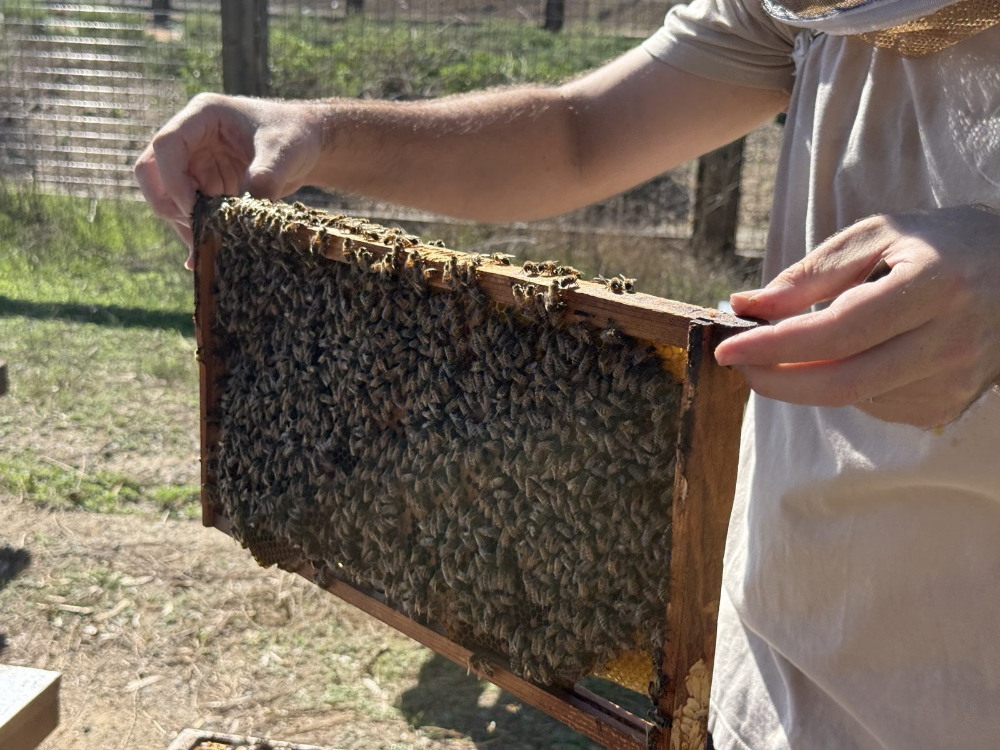

# The Honeybee Life Cycle — Jobs by Age, the Queen, and Swarms

**Summary**: What a honeybee does at each age, how a queen is made from an ordinary egg, how a colony splits in two, and how bees talk to each other — as explained by a beekeeper on the Fox Point Farms tour.

**Sources**: raw/source-docs/fox-point-bee-tour-2026-10-25.md and a photo taken on the tour, 25 Oct 2026 (the guide's own words; see [[fox-point-bee-tour]] for the claims to check before using any of it publicly)

**Last updated**: 2026-10-25

---

> Everything below is **the guide's account** (source: fox-point-bee-tour-2026-10-25.md) unless marked **ours**. He was talking to children, so some of it is simplified.

## One worker bee, from birth to the end

*A frame covered in workers — every bee here is female (photo, 25 Oct 2026).*

A worker lives about **two months**, and her job changes as she gets older. (source: parts 2–5)

| Age | Job | What she does |
|---|---|---|
| **Day 0** | Newborn | Can't see, can't fly. **Makes her bed** — climbs back into her cell and cleans it, so the queen can lay an egg in it at once |
| **First ~2 weeks** | **Nurse bee** | Feeds all the larvae. From **day 7 to day 14** her head glands make **royal jelly** — "the highest protein, most important resource in the hive" — and only for that one week. Learns the hive's **pheromones** |
| **A couple of days** | **Guard bee** | Stands at the entrance and checks every bee coming in has **the hive's smell**. Practises her flying patterns |
| **About 3 weeks to a month** | **Forager** | Out finding nectar and pollen. Dangers: getting lost, drowning, **spiders and other predatory insects** |
| **About 8 weeks** | **Scout** — "an elder of the hive" | Looks for new homes when the colony splits |

**All the bees you see working flowers are female.** "All girl bees do all the work."

## The queen

- **A queen is born from the same kind of egg as a worker.** What decides it is **where the egg goes and what it eats**: the workers put an egg into a special **queen cell** — long, about an inch, like a banana hanging off the comb — and flood it with **royal jelly**. (source: part 5)
- Workers make **several queen cells** "because they always hedge their bet".
- She **hatches in about two weeks**, much bigger, and able to mate.
- She lives **4–5 years**; a worker from the same egg would live about two months. "Just because of the diet."
- **One mating flight**, as soon as she can: she mates with **20–30 male bees** (the guide's "biker bar in the sky" — the males wait for a queen to fly through). She never needs to mate again and lays up to **2,000 eggs a day** for the rest of her life.

## When a hive gets full: the split

(source: part 5)

A hive that has run out of room — nowhere for the queen to lay, nowhere to store food — **splits**. The guide called it "completely normal in nature; it's how bees' populations grow".

1. A few days before, a **pheromone smell** tells the colony it's about to happen, and the workers start building queen cells.
2. The **old queen leaves with about half the bees** and **swarms** on a branch. The other half stays behind to **raise a new queen**.
3. On the branch, the swarm hangs together by **festooning**: bees hook their feet to each other "like monkeys in a barrel", which holds the swarm intact, and lets them pass nutrients and wax up and down the cluster. (source: part 11)
4. **Scouts** fly off to look for a new home — a hollow, a wall, an **irrigation box**. A scout measures it ("this could fit 10,000 of us"), comes back and does the **waggle dance** to say where it is. **Other scouts go and check it**; when they agree, the whole swarm moves in and starts again.
5. That is how a hive ends up in an irrigation box — and how the guide's rescue calls begin.

## How bees talk

**Smell.** Bees put off chemical smells — **pheromones** — that other bees can pick up. A colony has its own smell, which is how a guard bee knows who belongs. A pheromone also warns the hive that a split is coming. (source: parts 3, 5)

**The waggle dance.** A forager who finds a rich patch of flowers lands on the hive, laden with pollen ("**pollen pants**": pollen clings to her like static, she combs it down onto her back legs), and dances a **figure-eight walk**. (source: part 4)

| What the dance shows | How |
|---|---|
| **Direction** | By where the **sun** is, in the way she walks the dance |
| **Distance** | By **how long** the walk is |
| **How good it is** | By how hard she **shakes her tail end** in the middle — "the bee that is literally shaking more", the others follow, because "she is more excited about what they found" |

The same dance is used for **foraging** and for **scouting** a new home.

## Our link to the lacewing

**Ours, not the guide's.** The bee story and the lacewing story are the same story told twice: **one animal, different jobs at different ages.**

| | Honeybee worker | Green lacewing |
|---|---|---|
| Young | Nurse bee — stays in the hive, feeds the larvae | **Larva** — hunts aphids, up to ~200 before it is done |
| Later | Forager — out on the flowers | **Adult** — drinks nectar and honeydew, stops eating pests |
| What decides the role | **Age** (and diet, for a queen) | **Life stage** |

See [[lacewing-project]] and [[keystone-species]]. A pollinator garden (the guide's place where bees get "most of their action") is also where adult lacewings feed — the same flowers do both jobs. See [[biodiversity-at-the-farm]].

## Check before using

The guide's lifespan multiple ("50 to 70 times") does not match his own figures (4–5 years versus 2 months is about 25–30×); the "scout as elder" description and the royal jelly details are simplified; the queen-development timeline is muddled in the transcript. Full list: [[fox-point-bee-tour]].

## Related pages
- [[fox-point-bee-tour]]
- [[beekeeping-and-honey]]
- [[lacewing-project]]
- [[keystone-species]]
- [[biodiversity-at-the-farm]]
