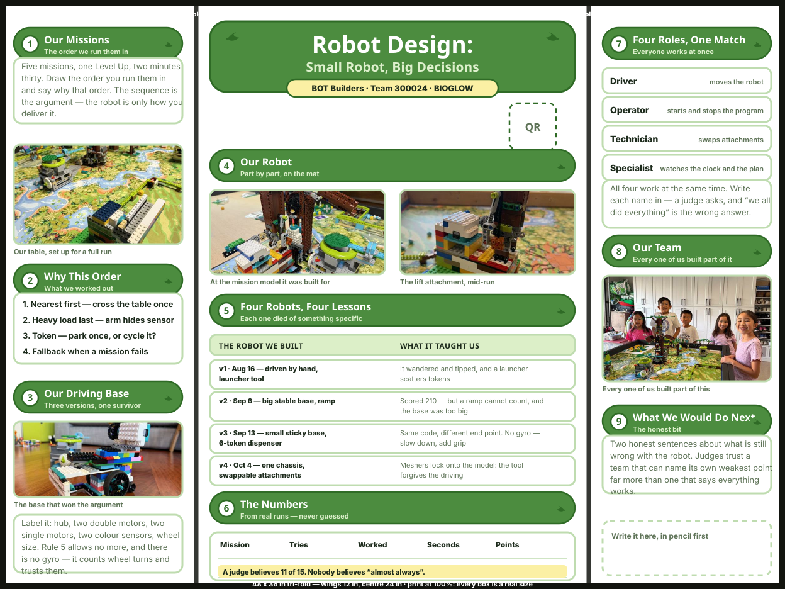
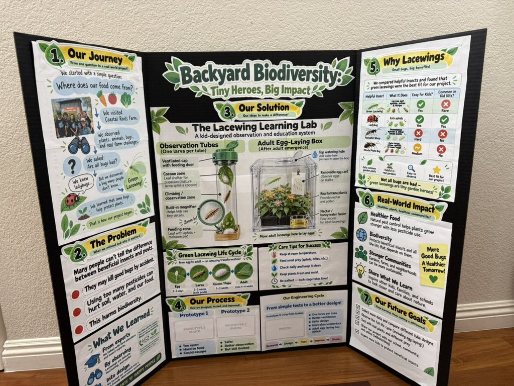
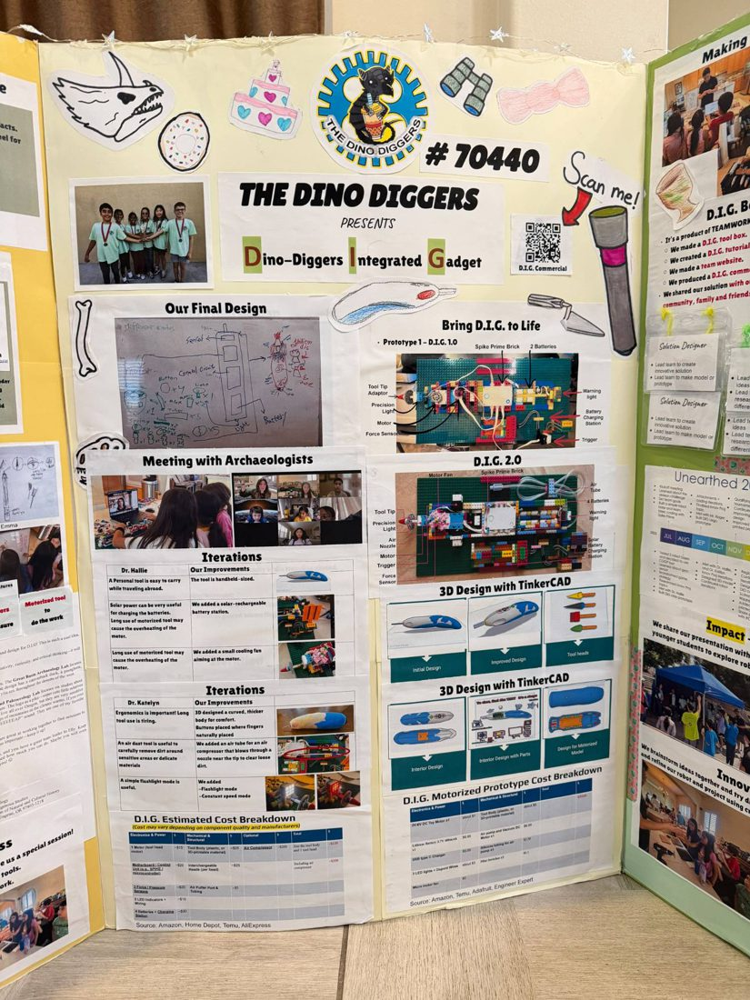
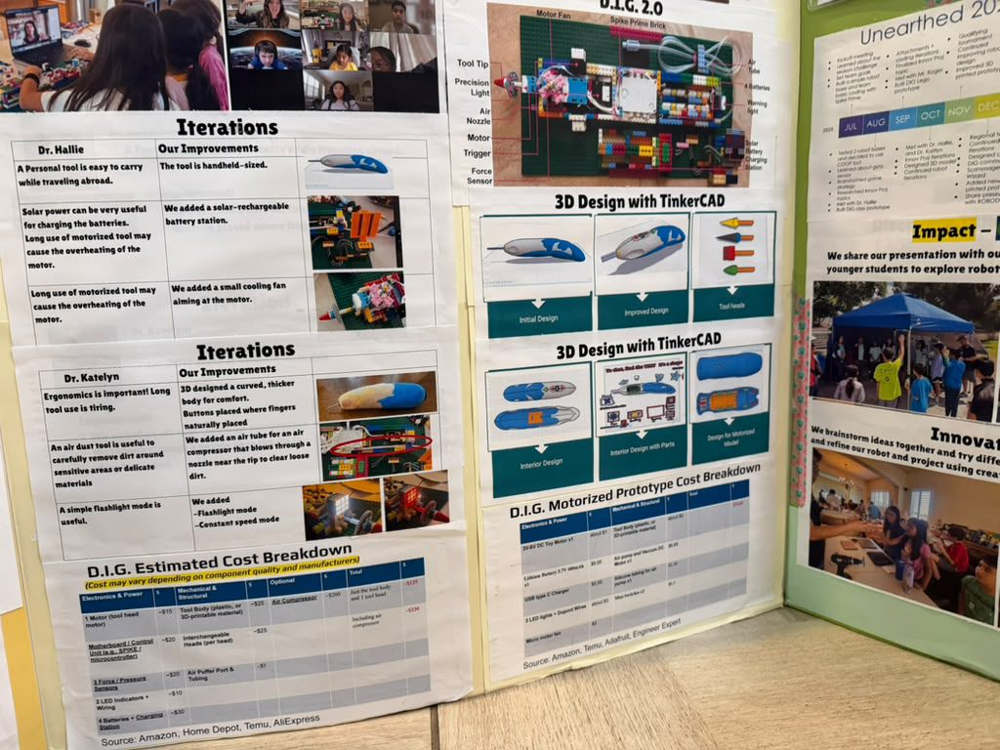

# The Robot Design board

**Summary**: The plan for the Robot Design tri-fold — what goes in each panel, which of our photographs fills each slot, and what still has to be measured before it can be printed. It is dressed to match our own Innovation Project board, and borrows its structure from the Dino Diggers board (team 70440).

**Sources**: raw/source-docs/robot-design-2026-10/ (nine photographs, October 2026 — our robot, our own Innovation Project board, and two of the Dino Diggers board); wiki/match-strategy.md; wiki/driving-base.md; raw/bioglow/fll-future-3-8-judging-rubric.pdf

**Last updated**: 2026-10-16

---

**[Open the layout full size](../assets/robot-design/board-layout.svg)** · regenerate with `python3 scripts/make_board.py`

It is drawn at true print proportions — **48 × 36 inches, wings 12 in, centre 24 in** — so every box on it is a real size. Print at 100% and the boxes are the boxes.

---

## It matches our own board

The Innovation Project board already exists and already works — **Backyard Biodiversity: Tiny Heroes, Big Impact**. Two boards standing next to each other at a tournament should look like they came from the same team, so the Robot Design board borrows its whole visual language:

{: width="520"}

| From our board | On the robot board |
|---|---|
| **Numbered green ribbons** with a white badge | Nine sections, numbered 1–9 in the reading order |
| A one-line kicker under each heading | Every ribbon says what its section is *for* |
| White cards with pale green outlines | Every block of text and every photo |
| A yellow pill under the title | Team, number, season |
| Leaf sprigs either side of a heading | Same sprig, drawn in code |
| Black tri-fold edge | Same board, same edge |

---

## What we took from the Dino Diggers

Their board is an Innovation Project board, not a robot one, but the **shape** of it is what makes it work, and that transfers:

| What they do | Why it works |
|---|---|
| A title block you can read across a room | A judge decides whether to walk over from ten feet away |
| **Two-column iteration tables** — *what we learned* beside *what we changed* | It proves a loop happened. A list of features does not |
| Every expert conversation shown with a photo | *"We met an archaeologist"* is a claim; the screenshot is evidence |
| A costed parts table | Nobody expects it, so it reads as serious |
| A QR code to a video | The board cannot move; the video can |
| Hand-drawn doodles around the edges | It still looks like children made it, which it should |

{: width="420"}
{: width="420"}

**The one thing not to copy: the density.** Theirs is packed to the edges because they had a full season of evidence. Ours has five weeks. A half-full board of real numbers beats a full one of filler.

---

## Panel by panel

### Left wing — mission design and the three sequences

The sequence *is* the argument; the robot is only how it gets delivered. Three sequences, because three is how many can run without queueing for one robot — see [[match-strategy]] and [[season-journal]] Week 11.

| | Route | Why | Who |
|---|---|---|---|
| **1 · the park route** | Young Forest → Nest → Hollow Tree | M01 pays **20 a token** for keystone species parked in a microbiome, three to a microbiome. M04 opens the nest and the hollow tree to release them | Cheryl · Lola |
| **2 · the cycle route** | Cave Waterfall × **50 loops** | M03 pays **5 every pass** — and the token comes back. 50 cycles is the biggest pool on the table. Lift tower, one-way-door grabber, rope loop | Kyle · Lindsey · Kei |
| **3 · the Operator tool** | Launcher into the Grand Tree | M02 Roots of Renewal: resources cycled up the tree, 5 at the base and more in the canopy. The grand tree motor belongs to the **Specialist**, so it never stops the driving base | Specialist · Operator |

**Sequences 1 and 2 are the two sides of the central tension** — park the tokens, or cycle them — and running both is the refusal to choose that the team made in Week 6 when they split the grand tree. Sequence 3 costs the driving base nothing, because it is somebody else's hands.

### Centre — the final design, then how we got there

**Part one: the robot we are taking.** The v4 chassis, bare and loaded, with the four things that make it the one we kept — one chassis with both motor types and a gear take-off, meshers, three identical bases, and small-light-sticky.

**Part two: the four versions**, each with its photographs, what went wrong, and what changed because of it. Full write-up in [[robot-evolution]].

Underneath, the run data: sequence by sequence, tries, worked, seconds, points. **Those cells are still empty.**

### Right wing — the team and the journey

The four roles with names against them, the team photograph, a dated timeline of twenty-five Sundays from the field being built to the January competition, and a box for what is still wrong with the robot.

## Before it can be printed

| | Still needed |
|---|---|
| ⬜ | **Timed runs.** Three columns of the numbers table are empty: tries, worked, seconds |
| ⬜ | **Names against the four roles** — unassigned since Week 6 |
| ⬜ | **The waterfall loop time** — one number, and it picks which sequence we run |
| ✅ | **Four real iterations** with dates — done, from [[robot-evolution]] |
| ✅ | **Robot photos** — v1 to v4 are on the board, with the current chassis bare and loaded |
| ⬜ | **The route attachment** photographed on the v4 base — the only version shot still missing |
| ⬜ | **The QR code** — `python3 scripts/make_qr.py "<run video URL>" "Watch a run" --out run` |

> **The numbers are the whole board.** *"Eleven of fifteen tries"* is worth more than any sentence on it. *"It almost always works"* is worth nothing, and a judge has heard it from every team before you.

## Related pages
- [[robot-evolution]]
- [[match-strategy]]
- [[driving-base]]
- [[judging-and-awards]]
- [[bioglow-missions]]
