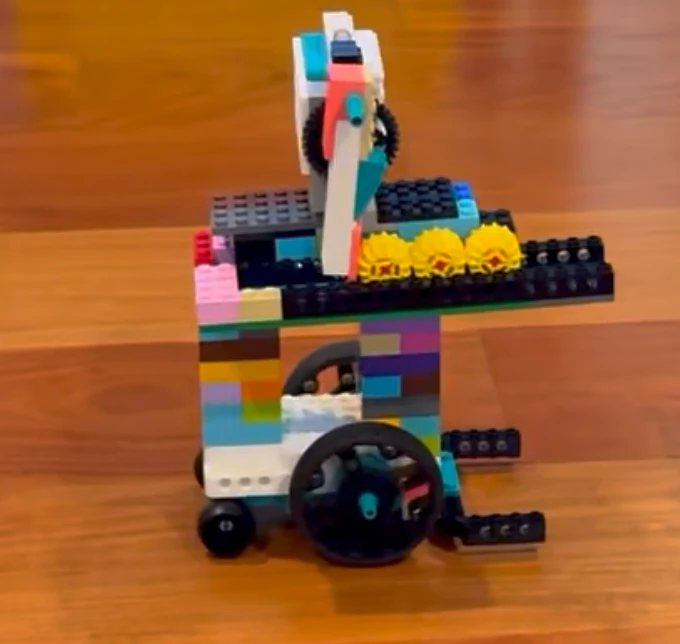
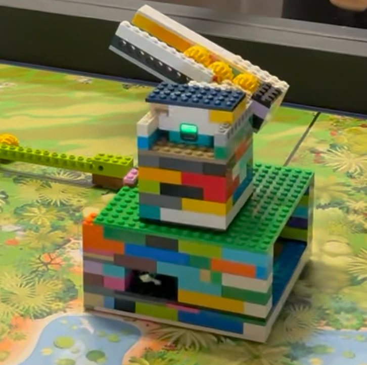
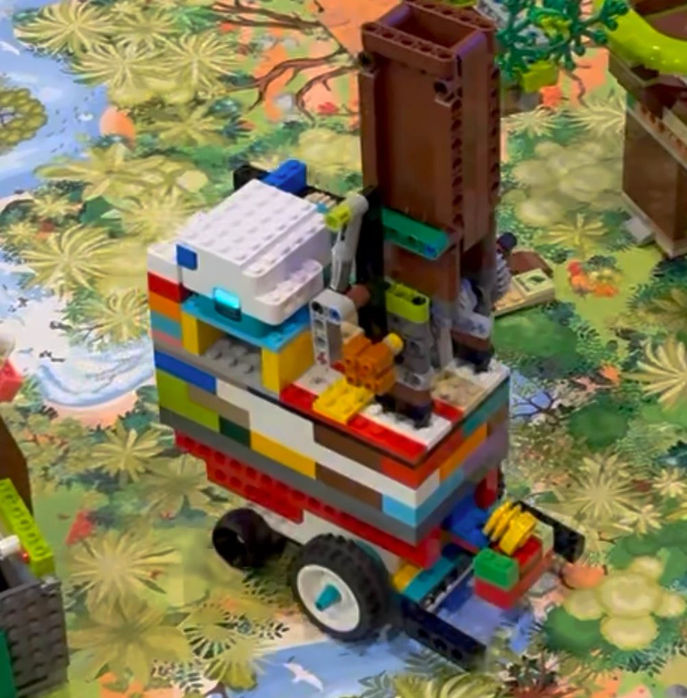
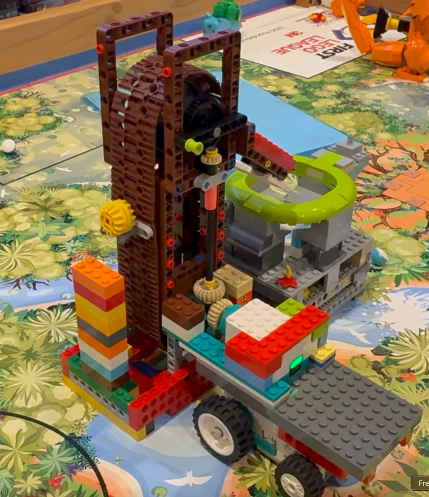

# Robot design evolution — four versions

**Summary**: How the robot got from a small base driven by hand to a single chassis with swappable attachments and self-aligning meshers, reconstructed from the journal. Four versions, what broke each one, and what the team changed because of it.

**Sources**: wiki/season-journal.md (Weeks 3–11); raw/whatsapp/team-chat-export-2026-09-18.txt; wiki/driving-base.md; wiki/match-strategy.md; raw/bioglow/fll-future-3-8-bioglow-rulebook.pdf

**Last updated**: 2026-10-17

---

> **This is the Robot Design story.** A judge does not score the robot you finished with; they score whether you can show *why* it is that robot. Four versions, each one caused by a specific failure, is the strongest evidence a team can bring.

| | Weeks | The robot | What killed it |
|---|---|---|---|
| **v1** | 3 · 16 Aug | Small base, driven by hand. Launcher tool | No control — it wandered and tipped |
| **v2** | 4–6 · 30 Aug – 6 Sep | Big stable base, collector, **ramp** | Could not control *how many* tokens came out |
| **v3** | 7–9 · 13–27 Sep | Small sticky-wheel base, **6-token dispenser**, driving on program | Straight lines and turns are not repeatable |
| **v4** | 10–11 · 4–11 Oct | One chassis, two motor types, **swappable attachments**, **meshers** | — current |

---

## The four of them, in photographs

| | | |
|---|---|---|
| {: width="250"} | **v1** · 16 Aug | Small base, hand-driven, launcher on a tower |
| {: width="250"} | **v2** · 6 Sep | Big stable base, ramp loaded with keystone species — the one that scored 210 |
| {: width="250"} | **v3** · 13 Sep | Small sticky-wheel base, dispenser on the side, working a model on the mat |
| {: width="250"} | **v3** · the other attachment | The same base with the cave-waterfall lift tower, docked at the model |
| *photo needed* | **v4** · 4 Oct | One chassis, both motor types, attachments on gears |

> **Three photographs are missing, and they are worth more than anything else on this page.** The Engineering Design rubric scores *exploring multiple options before selecting one*. Four robots side by side proves it in one glance; a paragraph claiming it does not. If v2 and v3 are already taken apart, say so on the board — a photograph of the rebuilt parts with *"we took it apart to build the next one"* is honest and still counts.

---

## v1 · Drive it yourself

{: width="420"}

**Week 3, 16 August.** All mission models built, all motors in, a Driver robot with basic code, a Technician launcher, an Operator tool. Five familiarisation runs at the full 2:30, rotating roles.

Look at what the photograph shows: a **tall tower on a short wheelbase**, the launcher mechanism up at the top with its gear, and the tokens carried on a rail along the side. Every bit of weight is high and the wheels are close together — which is the whole v1 problem in one picture.

**What went wrong.** A small base driven on the controller is **out of control** — it over-ran where it was aimed, and a tall light robot tips. The launcher *shot* keystone species at the mission models, which scatters tokens instead of placing them.

> **Learned:** aiming by hand at speed is not accuracy. Neither is throwing.

## v2 · Make it big and steady

{: width="420"}

The photograph shows both halves of v2 at once. Underneath: a **wide, two-tier brick chassis** — the opposite of v1's tall tower, and far harder to tip. On top: the **ramp**, angled up, with the keystone species sitting in a row along it.

And the row is the problem. The tokens are queued on an open slope with nothing between them, so the moment the ramp tips far enough for one to move, **they all move**. There is no mechanism in the picture that could hold token two while token one leaves.

**Weeks 4–6.** A rebuilt base — **strong, heavy, stable** — with a collector, and the launcher replaced by a **ramp on a slow single motor** that rolls tokens down into a microbiome. First real scores: **100 points** on 6 September, then a home run tallied at **210** the following day — three keystone species in one microbiome, three in a second, the invasive queen knocked down, the nest and the hollow tree emptied.

**What went wrong.** Two things, and they pull against each other:

- **The ramp cannot count.** Tip it and whatever is on it rolls out. M01 scores a **maximum of three** keystone species per microbiome, so a ramp that empties is either short or wasteful.
- **The base is too big.** Kevin's note from the day of the 210: *"the base is definitely a bit too big so it doesn't have much room for error."*

> **Learned:** stability is not the only thing that matters. A big robot needs a big margin, and this table does not have one.

## v3 · Small, sticky, and programmed

{: width="420"}

Set this against v2 and the shrink is obvious: the chassis is **shorter front to back**, the hub sits low and flat on top instead of on a stack, and the keystone species are no longer queued on an open slope — they are **held in a magazine at the side**, stacked between walls, where a mechanism can let go of some and keep the rest.

It is also photographed **doing the job**, pressed up against the mission model rather than standing on a table. That is the picture worth printing: a robot at the thing it was built for.

**Week 7, 13 September — three decisions in one afternoon**, and the most important week in the robot's life.

**1 · The base: small, simple, sticky wheels.** The team chose the *lighter* robot over the strong one. Lighter stops where it was told instead of sliding past; grippy wheels mean a counted rotation is a rotation that actually happened.

**2 · The dispenser replaces the ramp.** It carries **six** keystone species and releases **three at a time** — three because three is what a microbiome scores. One release fills one microbiome for 60 points and the second is already loaded. **This was the third delivery design: launcher → ramp → dispenser.**

**3 · Drive on program, correct on the controller.** The base runs its route under program. The team then found the thing this whole page is about: **the same code does not end in the same place twice.**

> **Learned — the big one:** straight lines and turns are not reliable. Speed changes them, weight changes them, battery charge changes them, and the start position is never identical. The robot has **no gyro** — it counts wheel rotations and trusts them.

**What they did about it, in order:**

| Attempt | Result |
|---|---|
| Slow the robot down | Better. Less overshoot, less slide |
| Sticky wheels | Better. A counted rotation is a real rotation |
| Driver nudges the last few millimetres | Legal — the rulebook allows controller *or* autonomous — and honest |

### The same base, a second attachment

{: width="460"}

This is the same v3 base wearing a completely different tool: a **tall brown lift tower** built from technic beams, with a gear train driving a carrier up and down, docked against the cave waterfall model. The token goes in at the bottom and comes out at the top.

**Two things in this photograph are worth pointing at on the board.**

**One — the base is doing nothing special.** It is the same small chassis, the same wheels, the same hub. All the intelligence is in the attachment. That is the idea v4 then makes official: *one chassis, two jobs.* It happened here first, by accident, because the team needed a second tool and had only one robot.

**Two — look at the height.** The lift is as tall as v1's tower, the thing that made v1 fall over. It works now because the mass sits **over the wheelbase** and the base underneath is wide and low. The lesson from v1 was never *"nothing tall"*; it was *"nothing tall and badly supported."*

This is the attachment that makes M03 worth chasing: it can cycle a keystone species through the waterfall around **fifty times**, which is the difference between a 5-point mission and the biggest points pool on the table — see [[match-strategy]].

**The route also came together here:** a loop across **Hollow Tree → Young Forest → Nest** with a connector between them, and a **separate attachment for the cave waterfall** that can cycle a keystone species through roughly **fifty times**. The Operator tools improved too — a **rubber band** doing the gripping, and a **one-way door** on the grabber that lets a token in and not back out: no motor, no timing, nothing to program.

> **Learned:** the cheapest reliability is a mechanism that cannot do the wrong thing.

## v4 · One chassis, two jobs, and meshers

**Week 10, 4 October.** Three identical driving bases, one per kit family, so two projects can run at once instead of queueing for one robot.

**The base design settled**: it carries **a double motor and a single motor together**, and **two attachments swap on gears**. One chassis, two jobs — the Hollow Tree / Young Forest / Nest route on one attachment, the cave waterfall on the other.

**And then the decision that matters most: meshers.** Parts shaped to fit the **hollow tree, cave waterfall and nest** themselves, so the tool locks onto the mission model on contact.

The kids' own reason for building them is the good one — *to avoid robot inconsistency between the software and the real table.*

> **Learned — the one to say out loud to a judge:** we stopped trying to make the driving perfect and made the tool forgiving instead. The robot only has to get **close**; the geometry does the rest.

---

## The five things we actually learned

1. **Hand-driving is not accuracy, and neither is throwing.** (v1)
2. **A heavy stable robot buys stability and spends margin.** Small and light stops where it is told. (v2)
3. **A delivery tool must control the count, not just the direction.** Three per microbiome, because three is what scores. (v2 → v3)
4. **Straight lines and turns are not repeatable** — speed, weight, battery and start position all move the end point, and there is no gyro to correct it. Slow down, add grip, and let the Driver fix the last few millimetres. (v3)
5. **Make the tool forgiving instead of making the driving perfect.** Meshers, one-way doors, rubber bands: mechanisms that cannot do the wrong thing. (v3 → v4)

---

## What still has no answer

| | |
|---|---|
| ⬜ | **Time one full waterfall loop.** Asked for in Week 7, still not measured. That single number decides the match sequence — see [[match-strategy]] |
| ⬜ | **How many runs out of how many** each attachment actually works. Four versions of story, no column of data |
| ⬜ | **Photographs of v2, v3 and v4.** v1 is filed; the other three are the evidence that the rubric actually scores |

## Related pages
- [[robot-design-board]]
- [[driving-base]]
- [[match-strategy]]
- [[season-journal]]
- [[robot-design-principles]]
